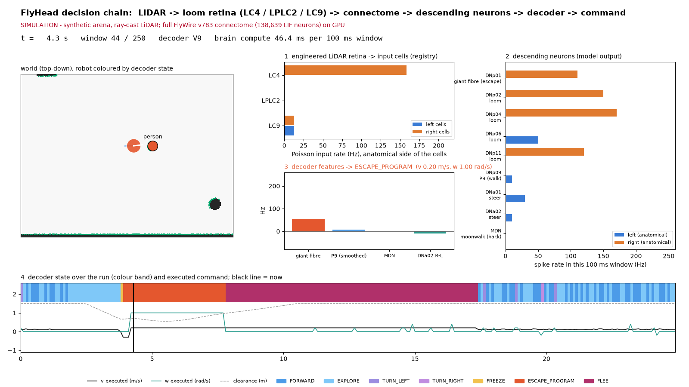
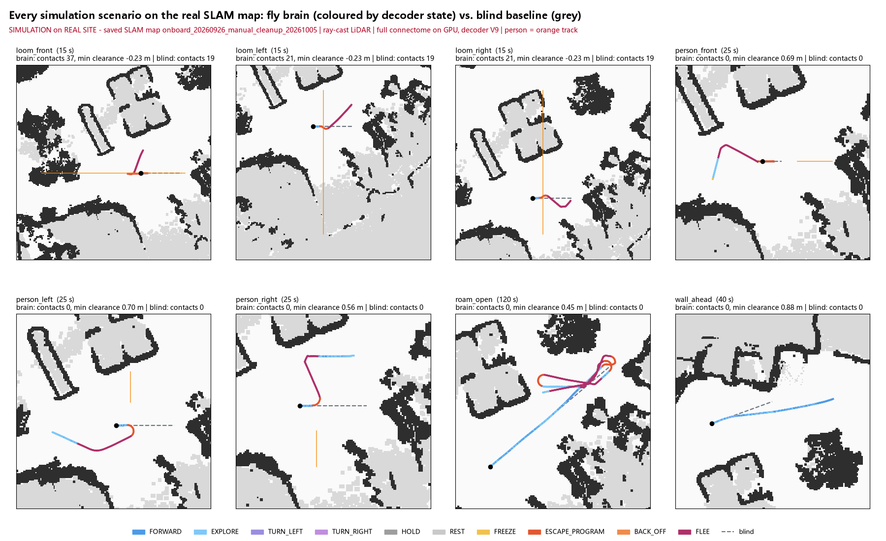
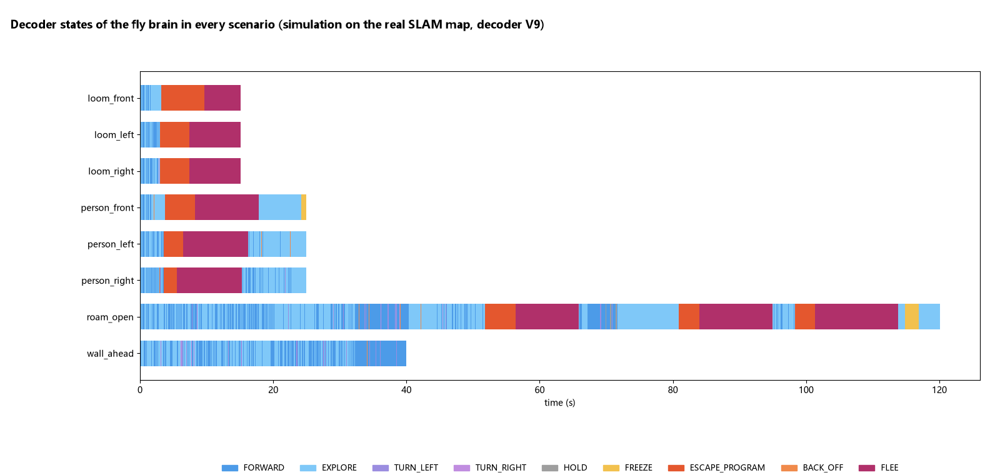

## Question

Can a whole-brain connectome simulation sit inside the control loop of a real robot? It has to keep up with 100 ms control windows, read real sensor data, and be contained so that a strange neural output cannot move the robot in an unsafe way.

FlyHead is my attempt at this on a DIABLO wheel-legged robot. The connectome is the FlyWire v783 *Drosophila* leaky integrate-and-fire (LIF) model from [eonsystemspbc/fly-brain](https://github.com/eonsystemspbc/fly-brain), fetched at a pinned commit with unmodified equations and no learning: 138,639 neurons and 15,091,983 connection records. Everything around the model is engineering work: how LiDAR becomes input, how output becomes motion, and what is allowed to reach the wheels.

## The loop, per 100 ms window

The robot (Raspberry Pi 4B, ROS 2 Foxy, Unitree L1 LiDAR at about 10 Hz) only streams sensors and executes velocity commands. SLAM, planning and the brain run on a GPU host.

| Step | What happens |
| --- | --- |
| Band filter | Keep LiDAR points 0.08–0.50 m above the floor, in the body frame. |
| Retina proxy | Pool points over 0.3 s into 24 bins of 15°. Angular expansion (looming) becomes a firing rate: 600 Hz per rad/s above a 0.12 rad/s deadband. Free space 0.5–2.5 m ahead drives LC9 up to 120 Hz. All rates are capped at 200 Hz. |
| Input cells | Poisson input to identified LC4, LPLC2 and LC9 cells, left and right. A scan older than 0.30 s gives zero input. |
| Connectome | The LIF model steps 100 ms of neural time in 10 blocks of 10 ms. |
| Readout | Spike rates of descending neurons per anatomical side: DNp01 (giant fibre), DNa02, DNp09, MDN and five other types. |
| Decoder | Rates become a state and a velocity, for example DNp09 at 60 Hz → 0.15 m/s forward, DNa02 right − left at 20 Hz → 0.40 rad/s, a DNp01 burst ≥ 60 Hz → escape program. |
| Envelope | The command may only be reduced or zeroed, with a 0.30 m/s ceiling. |

Neurons are bound by exact `cell_type` → `root_id` → model index. The registry holds 513 cells and is rebuilt from the annotation table and compared before use, so same-named cells in different columns are never merged.

*One simulated window (synthetic arena, ray-cast LiDAR): input rates (1), descending-neuron rates (2), decoder features (3), and the decoder state and executed command over the run (4).*

## Making 100 ms of neural time fit in 100 ms

The upstream step took a median of 222.7 ms per 100 ms window on the RTX 5090D, about 2.2× slower than real time. CUDA Graph capture on its own had given only 1.023× in an earlier trial, so most of the time was in the synaptic propagation.

The change that mattered was event-driven propagation. Every step still updates all neuron states, but propagation only walks the outgoing edges of neurons that spiked in that step, with an active list sized for all 138,639 cells so nothing is truncated. The model's weights are all integers, and the largest absolute input sum onto any target cell is 69,948, below 2^24. Spike inputs can therefore be accumulated exactly in int32 and converted to FP32 afterwards, which avoids the run-to-run differences of floating-point atomic adds.

| Fixed input | Upstream eager, median | Event-driven + CUDA Graph, median | Speed-up |
| --- | ---: | ---: | ---: |
| HS_LEFT | 222.69 ms | 45.87 ms | 4.85× |
| LC9_200 | 222.68 ms | 47.87 ms | 4.65× |

Timings are medians of 10 interleaved 100 ms runs per backend. For six fixed-input conditions of 500 ms each, whole-brain spike counts were identical to the upstream backend, and the final conductances, delay buffers, membrane potentials and refractory states differed by exactly 0. This equivalence holds for these conditions and for integer weights; I do not claim it for arbitrary models.

On the live system the GPU is shared with other jobs, and a window takes 84–110 ms (0.9–1.2× real time); on an idle GPU it takes 46 ms. A fresh clone reproduces all 629 recorded stage-1 rates exactly.

## Who is allowed to move the robot

The brain is never the only thing between a command and the wheels.

- **Modes.** `off`, `shadow` (decoded and logged, never sent), `drive` (brain commands go through the envelope) and `reflex` (the planner drives, and the brain takes over on FREEZE or ESCAPE).
- **Envelope.** It can reduce or zero a command, never raise one.
- **Leases.** Every velocity command carries a deadline of at most 0.3 s on the robot clock, and the robot zeroes motion after 2 s without server traffic.
- **Opt-ins.** Motion needs explicit switches on both the compute host and the robot, and a person with the RC transmitter stays at the robot during every drive.

Navigation (KISS-ICP SLAM, A* and pure pursuit at 10 Hz) works without the brain. I wrote about that half separately in [the navigation note](/writing/turning-point-navigation/).

## Results so far

| Result | Value |
| --- | --- |
| Shadow mode on the real robot (stage 4) | reaction 0.0–0.33 s to 9 approaches by an operator |
| Brain drive on the real robot (stage 5) | loom → escape decision median 0.35 s (0.09–1.08 s); 4 of 12 episodes not triggered |
| Contacts in brain drive | 0 in every drive where the operator recorded contacts |
| Simulation on the real SLAM map | person, wall and roam scenarios: 0 contacts |
| Loom stress tests (objects that never stop) | 21–37 contacts, against 19 for a robot without the brain |

*Simulation on the saved map of the real site. Grey dashes are a robot without the brain; the orange line is the approaching person or object.*

## Limits

The stimulus encoders and the decoder are engineering proxies, not a reconstruction of fly vision or motor control. EXPLORE and the arousal term are decoder-side additions, not connectome activity, and the records keep them apart.

The open problems are recorded rather than averaged away:

- Against a loom that keeps following, the robot escapes but still gets hit more often than the blind baseline (37 vs 19 in `loom_front`). Escape distance and direction against a pursuer are not solved.
- While standing, the robot overshoots keep-in and fence limits by 0.05–0.2 m.
- The stage-3 closed-loop simulation formally failed on one scenario because of a flaw in its own evaluation.
- The chassis-driver changes on the robot are not in the repository yet.
- A Jetson Nano cannot run the full connectome in real time: the neuron update alone is about 2× slower than real time, before any propagation.

The code, the neuron registry and the figures are in the [FlyHead repository](https://github.com/12sqawdwq/FlyHead), and [flyhead.live](https://flyhead.live/) has an interactive 3D walk-through.
