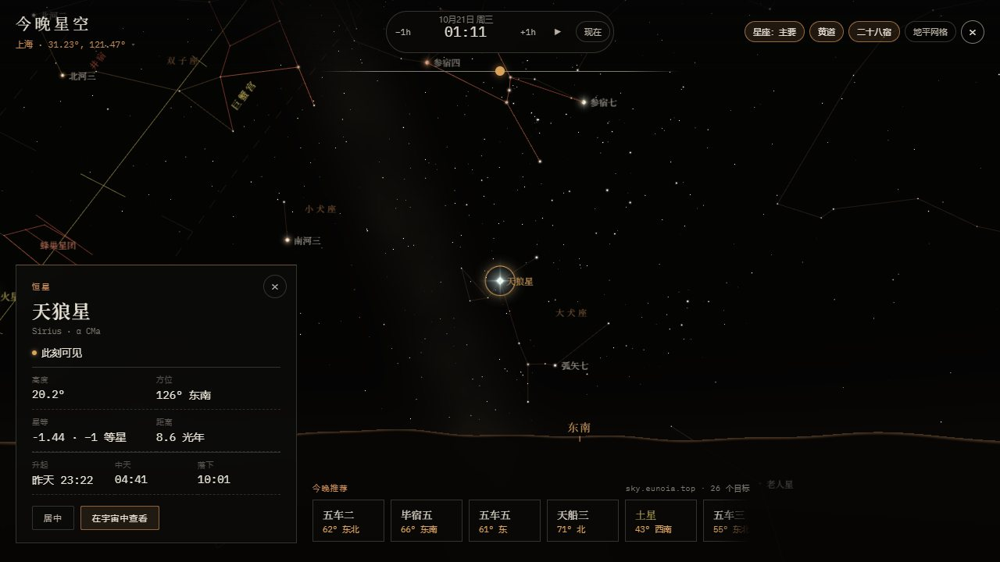
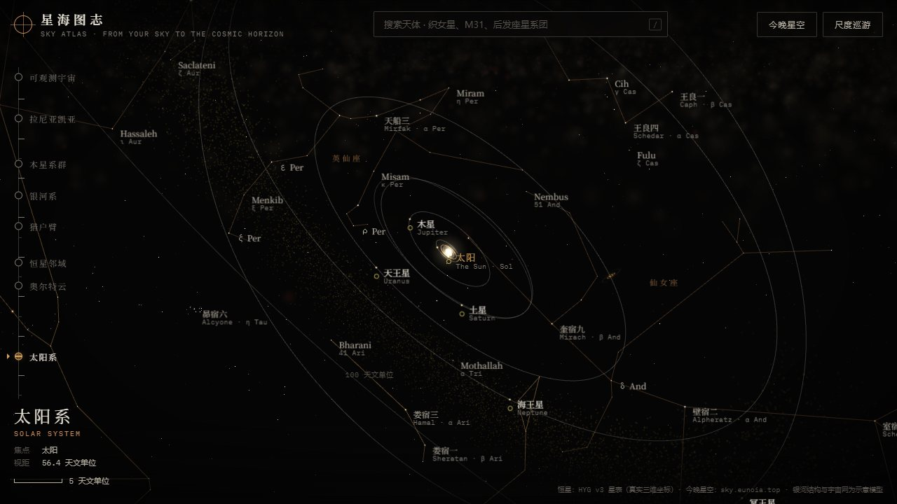
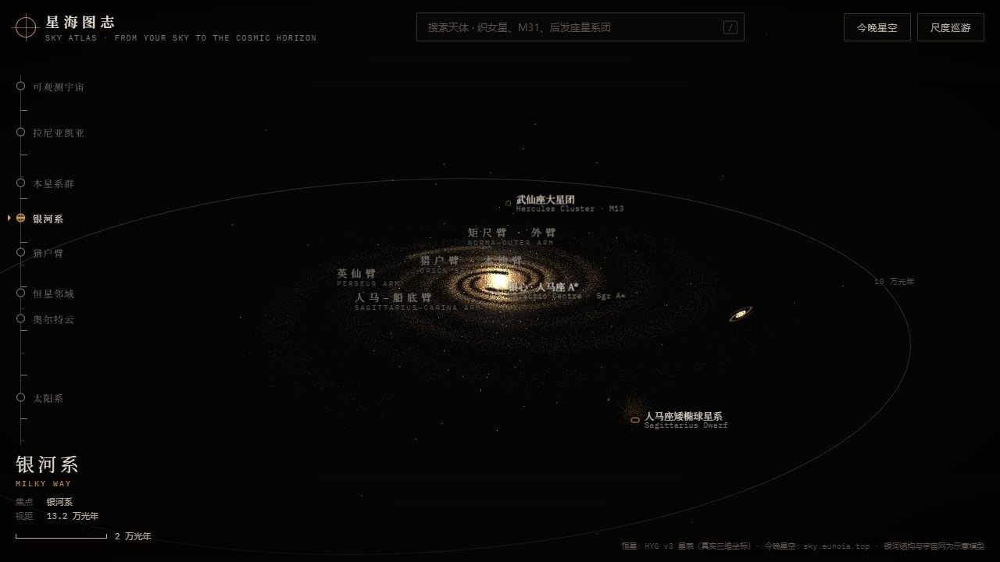
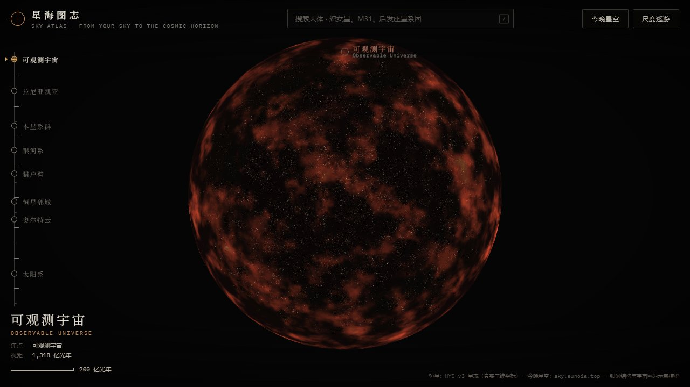

## What it is

[Sky Atlas](https://sky.eunoia.top/) has two halves. A FastAPI back end answers "what can I see from here, now?" for any place and time. A three.js front end, written in TypeScript with no UI framework, lets you zoom from tonight's sky out to the edge of the observable universe and back.

The back end started as a tool for voice queries on AI glasses, which is why it returns a compact, ranked list rather than a full catalogue. Its data sources:

| Objects | Source | Computation |
| --- | --- | --- |
| Stars | HYG v3, stars to magnitude 6.0, in SQLite | — |
| Deep-sky objects | Messier M1–M110 plus five NGC/Melotte targets | positions checked against OpenNGC |
| Sun, Moon and planets | JPL DE421 ephemeris | Skyfield |
| Stars and deep-sky positions | — | one bulk Astropy call converts them to altitude and azimuth |

## Problem 1: the brightest stars went missing

The first version of `/sky/chart` filled per-category quotas and sorted stars altitude-first. That looked fine at the default magnitude limit. When a client raised `star_max_mag`, more faint stars passed the filter, the quota filled with stars that happened to be higher in the sky, and Vega, Altair and Deneb dropped out of the answer.

The fix was to make the selection order explicit and remove the quotas:

1. **Filter** on what the client asked for: magnitude limits and minimum altitude. The altitude limit now applies to every object, including the Sun and Moon.
2. **Rank** by brightness. Altitude adds at most 0.5 to the priority, which only breaks ties.
3. **Cut** at `total_limit`, which is a ceiling, not a target.

A regression test now checks that bright stars are not crowded out when the limits change. The same release fixed two smaller honesty problems:

- **Placeholder distances.** HYG uses 100,000 pc for an unknown distance. The API now returns `null` instead of presenting the placeholder as a measurement.
- **The Sun.** The reasoning context never recommends the Sun as a target, and it adds a safety note whenever the Sun is up.

## Problem 2: sixteen orders of magnitude in float32

The atlas camera's orbit radius runs from about 0.4 AU (log₁₀ −5.2 in light-years) to about four times the radius of the observable universe (log₁₀ 11.6). A GPU vertex position is float32, which carries about seven significant digits, so a single world coordinate system cannot hold the Solar System and the cosmic web at the same time.

Three choices keep it stable:

- **A floating origin.** The camera always orbits (0, 0, 0). Each layer (Solar System, stars, Milky Way, galaxies, cosmic web) keeps its own origin, and every frame its group is placed at `layer.origin − focus`. That subtraction is done in float64 on the CPU, so the GPU only ever sees small numbers near the camera.
- **Near and far planes that scale with distance.** `near = r × 10⁻⁴` and `far = max(r × 10⁷, 10³)`, where *r* is the orbit radius. Point clouds and dust use additive blending with an explicit render order instead of depth testing.
- **Layers that fade over log-distance.** Each layer has an opacity window over log₁₀(*r*): it fades in over one range and out over another. For example, planet orbits are visible from −6 to −1.8, the Milky Way halo from 3.9 to 7.0, and the far cosmic web from 9.1 to 13.2. At any zoom level only a few layers are drawn, and handovers are cross-fades rather than pops.

Long camera flights use the same log scale. On a long hop the camera first pulls back to about log₁₀(travel × 1.6), moves sideways mostly while zoomed out, and then comes in again. Flight duration is clamped to 1.4–5.5 s.

## Level of detail by pixels, not by distance

Several objects change representation according to how large they appear on screen:

- **Stars.** Each star's brightness is computed per vertex from its absolute magnitude and the live camera distance. The stars come from HYG v3, about 109,400 of them.
- **Dust.** A dust particle smaller than a pixel dims instead of shrinking further, so it does not flicker.
- **Star clusters.** A cluster smaller than about 2.5–10 px hands over from its member stars to a single point of integrated light.

Globular clusters needed one more correction. ω Centauri (absolute magnitude −10.3) had 8,000 particles against M13's 5,000, so it looked sparse and sparkly rather than brighter. Now every globular uses the same light per particle, so a brighter cluster gets more particles: ω Cen has about 26,000. The Plummer scale radii were also recalibrated to published half-light radii: M13 10.9 ly, M22 10.4 ly and ω Cen 25 ly.

## What is measured and what is illustrative

The stars (HYG v3), the planets (J2000 mean elements and Kepler's equation, accurate to arcminutes) and the deep-sky positions are real data. The Milky Way is procedural (four logarithmic spirals with a 13° pitch and a 27° bar), the 18 cluster and nebula models are built from literature values, and the cosmic web is illustrative; its near nodes are anchored on real galaxy clusters. The atlas labels these layers as models.

The repository has 17 back-end tests and front-end tests for the astronomy helpers, the picks cache and the nebula models. One of those tests came from a real crash. In polar night the Sun's rise/transit/set solver returns no time, and an unchecked value crashed the render loop. The front-end tests now cover polar night, polar day and a year of high-latitude Sun, Moon and planet passes.

I have not measured frame rates or API response times systematically, so this note makes no performance claims. The code is in the [sky_monitor_api repository](https://github.com/12sqawdwq/sky_monitor_api).
