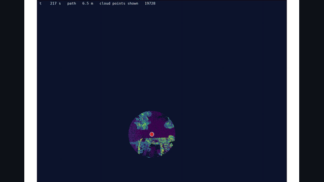
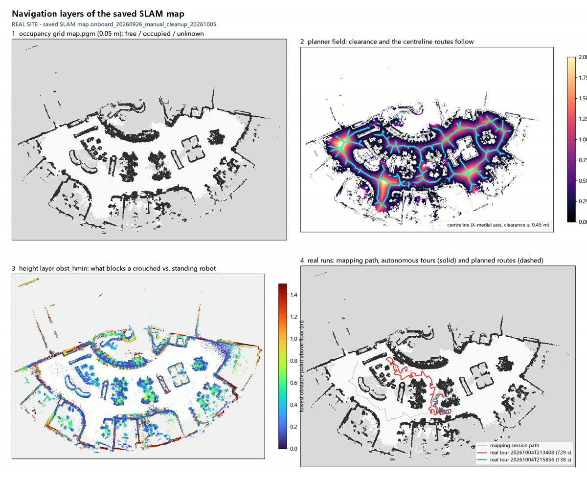

## Setting

The robot is a DIABLO wheel-legged robot with a Raspberry Pi 4B (ROS 2 Foxy) and a Unitree L1 LiDAR mounted facing backwards. Navigation is classical and does not use the [fly brain](/writing/flyhead-connectome-control/): KISS-ICP odometry with IMU rotational deskew, relocalisation on a saved map, A* route planning and pure pursuit at 10 Hz.

The system went through three layouts in two weeks. It started with the robot reachable only through a compute server, then the whole stack moved onboard so it could work without a network. The Pi was not real-time at 200–340 ms per frame. Since 6 October it has been distributed: SLAM, planning and control on a GPU host, sensor I/O only on the robot, and a Three.js console on the operator's PC. Velocity commands carry a deadline of at most 0.3 s on the robot clock, so a slow link stops the robot rather than letting an old command run on.

## The symptom

Up to 7 October, tours on the real robot failed in ways that looked unrelated:

- the robot rocked back and forth when starting;
- it reported "arrived" while still turning;
- tours were cancelled for leaving the route;
- the body cut inside every curve.

The best tour by then covered 35.46 m of a 213 m route, with 6 detours. Each symptom had a plausible local cause (controller gains, arrival tolerance, localisation noise). Earlier changes, such as a regulated pure-pursuit controller with turn hysteresis and rate limits, treated them one at a time.

## The cause

The controller tracked a "body centre" 0.45 m *ahead* of the LiDAR. That is not the point the robot turns about. To find the real one, I fitted the fixed point of 47 in-place turns from four runs. It lies 0.11 m *behind* the LiDAR, with a residual under 1 cm.

So the controlled point sat 0.56 m in front of the turning point. Every turn in place swung it sideways by about 0.45 m per 46°. The pursuit controller saw that as a sudden lateral error and corrected it; the arrival check saw the point sweep through the goal; and the deviation monitor saw the robot leave the route. All four symptoms came from one wrong offset.

The old simulator turned the robot about the controlled point, so it could not show the bug. The new simulator turns the robot about its measured turning point, with the LiDAR 0.11 m ahead of it, a 0.25 s command lag, and pose noise.

## The rebuild

Everything is now planned and controlled on the turning point, with the body modelled as a 0.35 m disc around it. The navigation was rebuilt around that:

- **Centreline routes.** Routes follow the λ-medial axis of free space (λ = 0.8 m, only cells with at least 0.45 m clearance), so between two walls the robot keeps equal clearance on both sides.
- **A\* on a 0.10 m grid.** The step cost is 1 + 39*r*², where *r* is the offset ratio from the centreline: 0 on it, approaching 1 at a wall.
- **Pure pursuit.** It tracks the turning point with a lookahead of 0.5 m + 4 s × speed, capped at 1.0 m.
- **No timer replanning.** A committed route only changes for a confirmed obstacle (a debounced local detour) or a sustained deviation (a short rejoin route).
- **Cusps.** Out-and-back turnarounds are handled explicitly, so progress along a route that passes the same place twice cannot jump between its two legs.

*Panel 2 shows the clearance field and the cyan centreline network that routes follow. The tours in panel 4 are from 4 October, before the rebuild.*

## Results

In closed-loop simulation on the same map, from the same two tour starts at 0.10 m/s:

| Tour start | Navigator | Result | Centre offset ratio, median / p90 |
| --- | --- | --- | --- |
| facing east | previous | cancelled at 9.1 m: deviation over 0.75 m | 0.14 / 0.28 |
| facing east | rebuilt | complete, 72.0 m | 0.00 / 0.07 |
| facing west | previous | stuck after 17.6 m, with contact | 0.24 / 0.52 |
| facing west | rebuilt | complete, 72.8 m | 0.00 / 0.07 |

The first standing tour on the real robot then exposed a second problem: localisation drifted by about 2° of heading over 25 m. KISS-ICP keeps at most 6 points per voxel and fills the voxels around the robot with its own scans first, so the saved map barely constrained the pose. The fix aligns the current scan to the saved map about once per second and applies a confident correction at half strength. Corrections larger than 0.3 m or 5° are rejected.

After that, the full 71.2 m tour on the real robot finished in 11.3 minutes on a single route, with no replans. Tracking error had a median of 0.06 m, a p95 of 0.20 m and a maximum of 0.35 m. 582 map corrections were applied and none rejected.

## Still open

- **Stall holds.** 64 s of that run were holds caused by link or LiDAR stalls on the robot side.
- **Optimistic stopping constants.** The host's stop-distance constants are based on commanded speed. Standing, the robot moves 1.3–2× the command.
- **Turbo slip.** In a fast Turbo run the pose slipped about 0.5 m during a turn. The correction limit rejected the right fix, and the cause does not reproduce offline.
- **Slow onboard hardware.** Neither the Pi nor a Jetson Nano is fast enough to run this SLAM onboard. That is the reason for the distributed layout, not a design preference.

The lesson I keep from this: when several failures show up together, check the geometry the controller assumes before tuning anything. One wrong offset was behind most of two weeks of symptoms, and a simulator built on the same assumption had hidden it.
